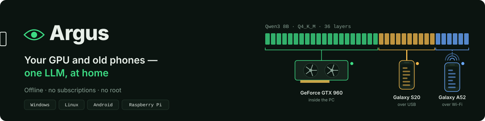
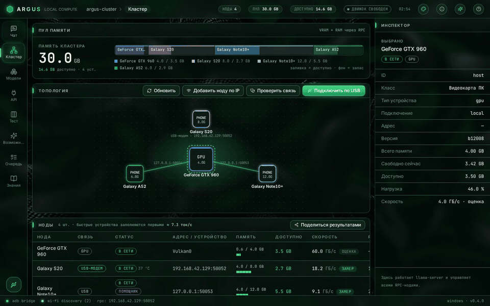
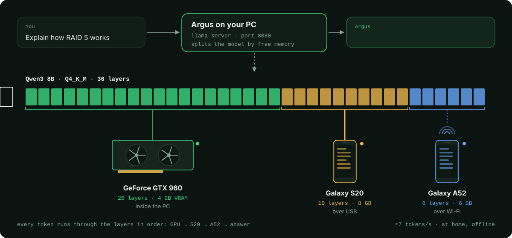
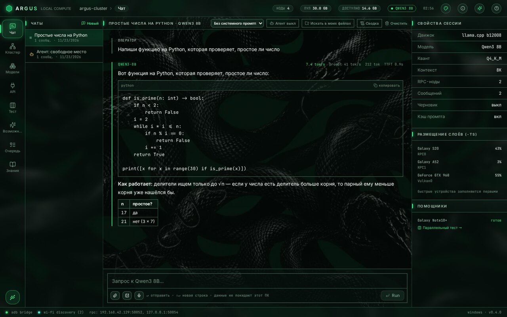
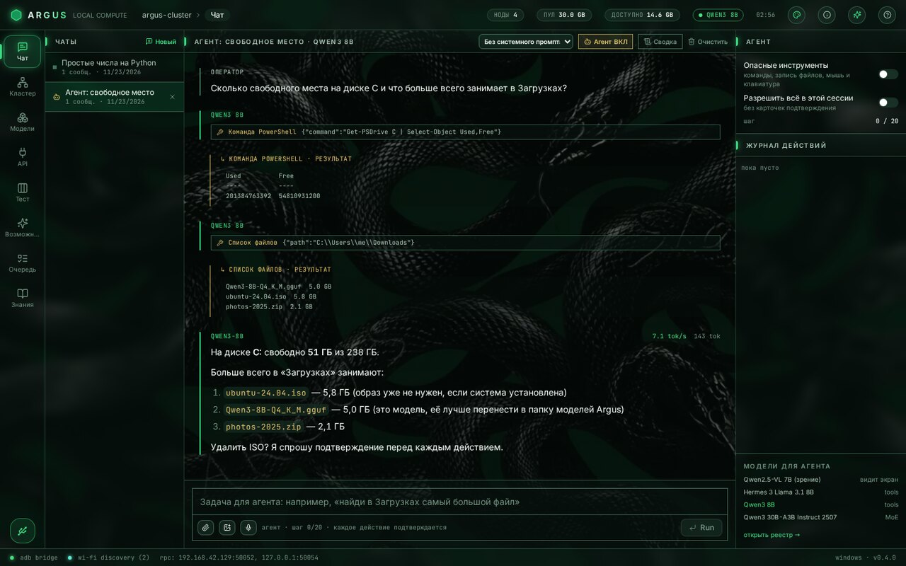
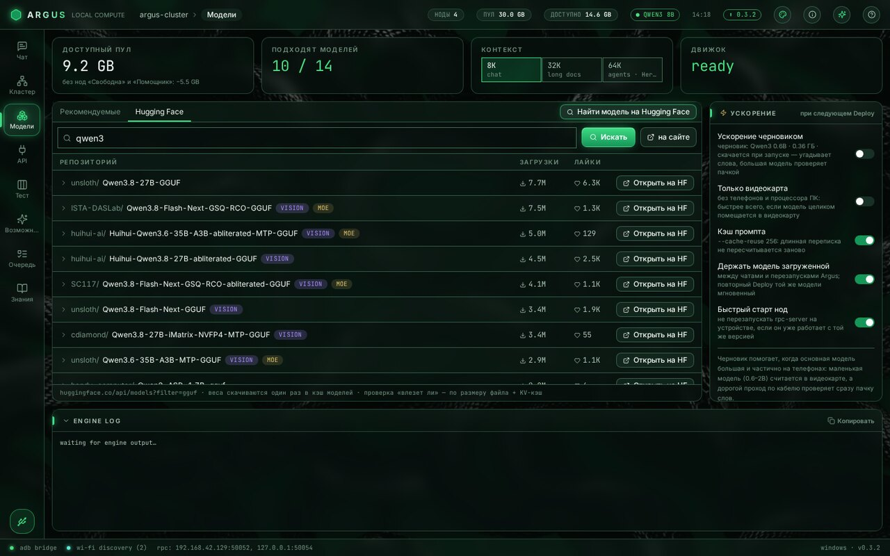
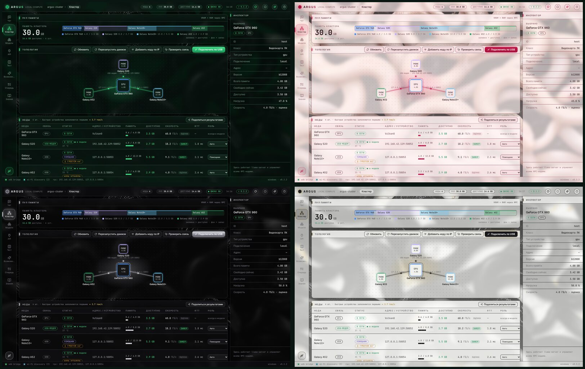
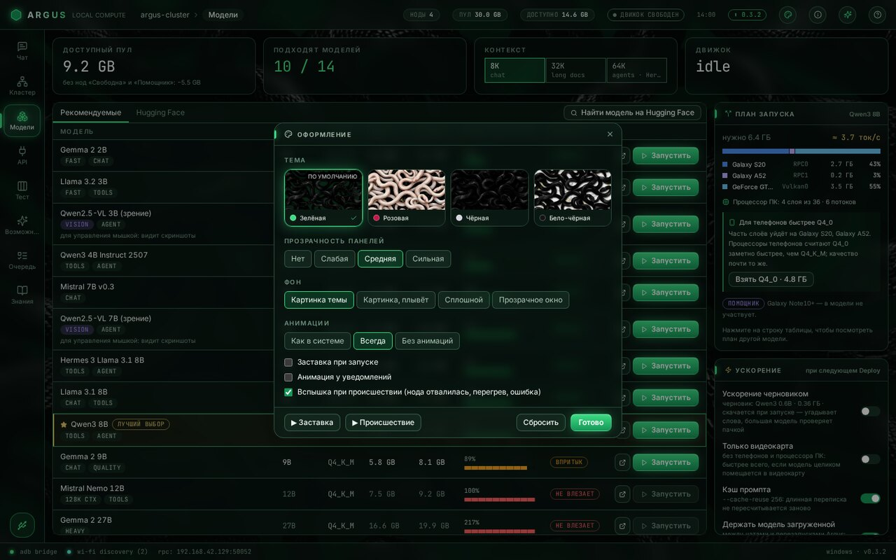

<div align="center">



<a href="../../releases/latest"></a>
<a href="../../releases"></a>
<a href="../../stargazers"></a>


### [Download](../../releases) · [Quick start](#quick-start) · [Linux](#linux) · [Second PC](#second-pc--laptop-as-a-node) · [Speed](#is-it-fast) · [Your own model](#your-own-model) · [What's new](#whats-new-in-v2-04) · [Support](SUPPORT.md) · [Русский](README.md)



<sub>Cluster → model → chat → four themes. Recorded in demo mode.</sub>

**Built by one person on a GTX 960. If it's useful to you, [chip in for test hardware](SUPPORT.md) ❤️**

</div>

<table>
<tr><td width="33%" valign="top"><h3>Models bigger than your GPU</h3>Layers split across GPU, CPU and phones</td><td width="33%" valign="top"><h3>Old phones put to work</h3>USB, tethering or Wi-Fi, no root</td><td width="33%" valign="top"><h3>OpenAI-compatible API</h3>Open WebUI, Jan, Continue, Hermes</td></tr>
<tr><td width="33%" valign="top"><h3>Agent on your PC</h3>You approve every action</td><td width="33%" valign="top"><h3>Linux and Raspberry Pi</h3>A node in one command or a ready image</td><td width="33%" valign="top"><h3>Everything stays home</h3>Offline, PIN mode for nodes</td></tr>
</table>

## What it is

A decent LLM wants 16–24 GB of VRAM. I have a GTX 960 with 4 GB. But I also have a few old Android phones with 6–12 GB of RAM each.

Argus joins your PC and your phones into one llama.cpp cluster. Phones connect over USB or Wi-Fi, the model's layers are split across the GPU, the PC's CPU and the phones, and you just chat. Everything runs at home: no cloud, no subscription.

No root needed. The phone gets a regular app, Argus Node, which runs llama.cpp's `rpc-server`.

## How it works

<p align="center"></p>

Argus benchmarks each device on connect (speed and free memory) and hands out layers so tokens come out as fast as possible. If the model fits in VRAM alone, phones aren't used at all, because that's fastest.

- PC side: Tauri 2 app (Rust + React/TS) running `llama-server` (llama.cpp b12008, Vulkan or CUDA) with `--rpc` pointing at the nodes.
- Phone side: native APK with a static musl `rpc-server`. USB goes through `adb forward` or, since 0.3.4, through USB tethering. On my setup (GTX 960 + phones, Gemma 2 2B) tethering took generation from 16 to 36 tokens/s compared to `adb forward`. Wi-Fi nodes announce themselves via UDP beacon on port 50053.
- Linux PCs, Raspberry Pi and a second Windows PC can be nodes too: see [Linux](#linux) and [Second PC / laptop as a node](#second-pc--laptop-as-a-node).

## Features

- Plug a phone in, allow USB debugging, and Argus installs the node app and starts it.
- Hugging Face search inside the app, with a "will it fit" check and one-click download.
- Chat with multiple conversations, code blocks, files and live tokens/s.
- OpenAI-compatible API: works with Open WebUI, Jan, Continue, Hermes.
- Speculative decoding: a small draft model on the GPU, the big one verifies.
- MoE models like Qwen3 30B-A3B: experts live on the phones, only a small part of the model works per token.
- Thermal-aware split: a hot phone gets less work.
- Phones as helpers: a small model for titles and summaries, voice input (whisper.cpp), offline Wikipedia (Kiwix .zim) as a tool for the model.
- Chat from any phone on your home network via QR code (PIN-protected), image input, RAG over your folders, overnight queue, Telegram bot.
- Never updates itself silently: every update (PC or phone) asks first and is checked against SHA-256.

<table>
<tr>
<td><br/><sub>Chat: code, tables, live speed</sub></td>
<td><br/><sub>Agent works on your PC, every step visible</sub></td>
</tr>
<tr>
<td><br/><sub>Models: what fits your pool</sub></td>
<td><br/><sub>Any GGUF model from Hugging Face</sub></td>
</tr>
<tr>
<td><br/><sub>Four themes: green, pink, black, black &amp; white</sub></td>
<td><br/><sub>Appearance: theme, glass, background, animations</sub></td>
</tr>
</table>

## What's new in v2 (0.4)

- **New design.** Four themes (green by default, pink, black, black & white), translucent glass, background and animations on start and on incidents. Palette button at the top.
- **Linux done properly.** AppImage and .deb in releases, plus a [step-by-step tutorial](docs/LINUX.en.md) for first-time terminal users.
- **Second PC in one command.** Windows and Linux become nodes with a script and show up under "Found on network". See [docs/PC-NODE.en.md](docs/PC-NODE.en.md).
- **"Check connection".** When a node won't connect, Argus walks through network, port, firewall and version and tells you what to fix.
- **Secured mode.** Lock a node with a PIN so only paired PCs can connect. [docs/SECURITY.en.md](docs/SECURITY.en.md).
- **First-run wizard.** Language, devices, first model in five steps.
- **Node roles.** Helper by default answers short questions, the main model takes the heavy ones; new Search role. [docs/ROLES.en.md](docs/ROLES.en.md).
- **Raspberry Pi image.** Flash, power on, the Pi joins the cluster. [docs/RASPBERRY-PI.en.md](docs/RASPBERRY-PI.en.md).
- **Updates only from this repository** (the old build looked at a previous address).
- Full English UI and docs.

## Quick start

<p align="center">
<a href="https://github.com/slopmaster1884/Project-argus/releases/latest/download/Argus-Setup.exe"></a>
<a href="../../releases/latest"></a>
<a href="https://github.com/slopmaster1884/Project-argus/releases/latest/download/Argus-Node.apk"></a>
</p>

1. Get **Argus-Setup.exe** (Windows) or AppImage / .deb (Linux) from [releases](../../releases).
2. On the phone: Settings → About phone → tap "Build number" 7 times → Developer options → **USB debugging**.
3. Plug in the cable and accept the debugging prompt.
4. In Argus press **"Pick a model and start"**.
5. When the status says "Ready", chat.

The installer isn't signed yet, so SmartScreen may complain: "More info" → "Run anyway".

Without a cable: turn on "Wi-Fi режим" in Argus Node and the phone appears under Cluster → "Найдено в сети" (Found on network).

## Linux

Argus runs on Linux too (AppImage / .deb): you need a Vulkan driver, and udev rules for USB phones (`sudo apt install android-sdk-platform-tools-common`).

To turn a Linux PC, laptop or Raspberry Pi into a **helper node**, run one command in a terminal:

```
curl -fsSL https://raw.githubusercontent.com/slopmaster1884/Project-argus/main/scripts/install.sh | bash
```

The installer checks everything, asks about the firewall and autostart, and tells you what to click in Argus. Step by step for beginners: [docs/LINUX.en.md](docs/LINUX.en.md).

**Raspberry Pi without a terminal:** the ready-made «Argus Node» image (roadmap 0.4). Write it to a card with Raspberry Pi Imager, insert, power on, and ~2 minutes later the Pi shows up in "Found on network". Step by step: [docs/RASPBERRY-PI.en.md](docs/RASPBERRY-PI.en.md).

## Second PC / laptop as a node

A second computer (Windows or Linux) can lend Argus its memory and GPU over your home network. It doesn't need Argus installed.

- **Windows:** Win + R → `powershell` → paste and press Enter:
  ```
  irm https://raw.githubusercontent.com/slopmaster1884/Project-argus/main/scripts/argus-node-windows.ps1 -OutFile $env:TEMP\argus-node.ps1; powershell -ExecutionPolicy Bypass -File $env:TEMP\argus-node.ps1
  ```
  Or download the project and double-click `scripts\argus-node-windows.cmd`.
- **Linux:** the command from the section above.

Then on the main PC: **Cluster → "Найдено в сети" → "Добавить"** (or "Добавить ноду по IP" / Add node by IP). Details and what to do if it doesn't show up: [docs/PC-NODE.en.md](docs/PC-NODE.en.md).

⚠ The node has no password: home network only, never expose port 50052 to the internet.

## What fits

| Total memory | Model | Good for |
|---|---|---|
| 4–6 GB | Qwen3 4B | Q&A, translation |
| 8–10 GB | Qwen3 8B, Hermes 3 8B | Code, agent |
| 10–12 GB | Qwen2.5-VL 7B | Images |
| 18 GB+ | Qwen3 30B-A3B (MoE) | Smartest, still fast |

## Security, honestly

llama.cpp's `rpc-server` has no authentication. In Wi-Fi mode and in USB tethering mode the phone listens on port 50052 on all interfaces, so anything on the same Wi-Fi can connect to it. In plain USB mode (adb forward) only the PC can reach it.

So: use Wi-Fi and tethering modes only on your own home network, and never expose ports 50052, 50053, 50061, 50063 or 50080 to the internet. Optional secured mode (“Защищённый режим” in Argus Node, `ARGUS_SECURE=1` for the Linux node) lets only PCs paired with the node’s PIN connect. It adds no encryption — see [docs/SECURITY.en.md](docs/SECURITY.en.md) for the threat model.

## Is it fast?

Generation speed, roughly. It depends on your phones, cables and Wi-Fi, so Argus shows its own "≈N tok/s" estimate for your setup before launch.

| Hardware | Model | Speed |
|---|---|---|
| GTX 960 4 GB + phones over USB tethering | Gemma 2 2B | ~36 tok/s (measured) |
| same, over adb | Gemma 2 2B | ~16 tok/s (measured) |
| GTX 960 + a fast phone | Qwen3 4B | ~14 tok/s (measured) |
| GTX 960 + 3 phones, ~14 GB pool | Qwen3 8B | ~7 tok/s (app estimate) |

Fastest is a model that fits entirely in the GPU: then Argus leaves the phones alone. USB tethering is about 2× faster than adb, Wi-Fi is slower than a cable, and Q4_0 runs faster on phones than Q4_K_M. Phones get warm: take them out of the case and cap charging at 85% if your phone supports it.

Got your own numbers? "Share results" on the Cluster tab builds a table without serial numbers. Post it in Issues and I'll add it here.

## Your own model

Any GGUF model that llama.cpp b12008 supports works.

1. **Models → Hugging Face**, type a name (e.g. `qwen3` or `gemma`).
2. Expand a repository and pick a quant file. The Fit column tells you right away whether your cluster has enough memory.
3. Press **Deploy**: Argus downloads the file once and spreads the layers across your devices.

Tips: Q4_0 or Q4_K_M for phones; the agent needs a model tagged tools and the 64K context preset.

## For developers

Architecture and build: [docs/ARCHITECTURE.md](docs/ARCHITECTURE.md). Node roles and protocol: [docs/ROLES.md](docs/ROLES.md) (Russian for now).

Note for anyone shipping static musl servers on Android: patch `accept` → `accept4(..., SOCK_CLOEXEC)`, otherwise seccomp kills the process with SIGSYS on arm64.

## Support

Argus is free and will stay free. If it helped you, [support it here](SUPPORT.md). Everything goes to test hardware.
