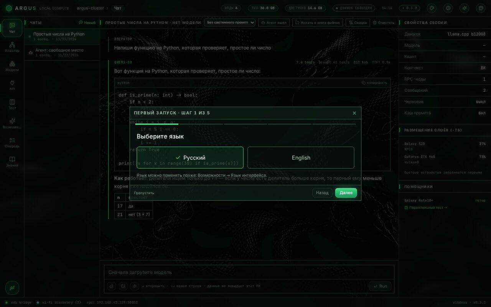
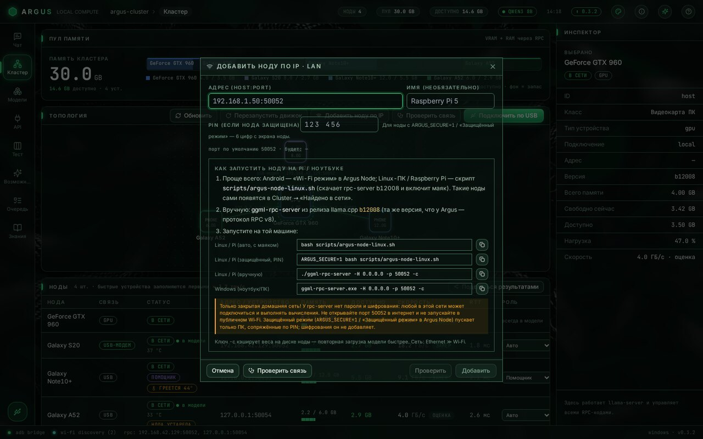
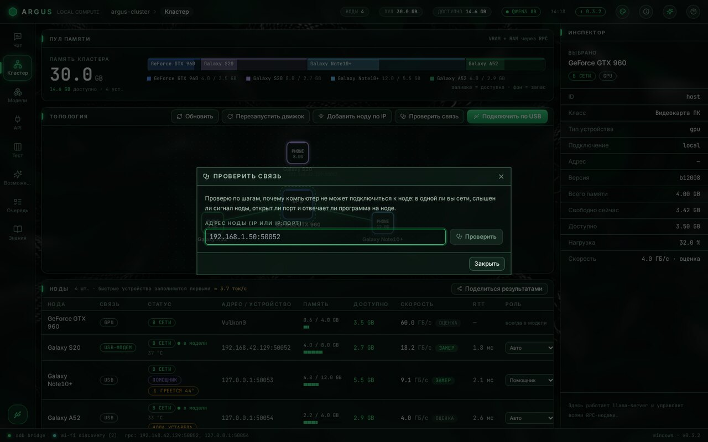

# Argus on Linux: step by step, for people who have never opened a terminal

[Русская версия](LINUX.md) · A second Windows PC as a node: [PC-NODE.en.md](PC-NODE.en.md) · Raspberry Pi without a terminal (ready image): [RASPBERRY-PI.en.md](RASPBERRY-PI.en.md)

> Everything that starts with `$` is typed into the **Terminal** (without the `$` itself).
> Open a terminal: **Ctrl + Alt + T** (Ubuntu, Mint, Pop!_OS) or find "Terminal" in the app menu.
> Paste into a terminal: **Ctrl + Shift + V** (plain Ctrl+V does not work there).

## Fastest way: one command (turn this Linux machine into a helper node)

Open a terminal, paste this line and press Enter:

```
$ curl -fsSL https://raw.githubusercontent.com/slopmaster1884/Project-argus/main/scripts/install.sh | bash
```

The installer checks your system, tells you what is missing (and asks before installing anything with `sudo`), opens the firewall port (asks too), turns on autostart and at the end prints **in big letters the IP address** of this computer and what to click in Argus. Details in [section B](#b-linux--helper-node).

> If you see `curl: command not found`, first run `sudo apt install curl` (Ubuntu/Mint), `sudo dnf install curl` (Fedora) or `sudo pacman -S curl` (Arch).
>
> The installer speaks Russian if your system language is Russian and English otherwise. Force English: `… | ARGUS_LANG=en bash`.

## What do you want to do?

| I want to… | Go to |
|---|---|
| Run Argus on this Linux computer and chat with the model here | [A. Linux as the main computer](#a-linux-as-the-main-computer) |
| Make this Linux laptop/PC **help** another computer that runs Argus | [B. Linux — helper (node)](#b-linux--helper-node) |
| Something doesn't work | [C. Troubleshooting](#c-troubleshooting) |

---

## 0. Find out which Linux you have (30 seconds)

```
$ cat /etc/os-release | head -2
```

- You see **Ubuntu, Linux Mint, Pop!_OS, Debian, Zorin** — use the "Ubuntu/Mint" rows below.
- You see **Fedora** — use the "Fedora" rows.
- You see **Arch, Manjaro, EndeavourOS, CachyOS** — use the "Arch" rows.

## A. Linux as the main computer

### Step 1. Install the graphics driver (Vulkan)

Argus runs the model on your graphics card through Vulkan. Check whether you have it:

```
$ vulkaninfo --summary | grep deviceName
```

If you see the name of your graphics card, go to step 2. If you get "command not found" or nothing:

| System | Command |
|---|---|
| Ubuntu/Mint | `sudo apt install mesa-vulkan-drivers vulkan-tools` |
| Fedora | `sudo dnf install mesa-vulkan-drivers vulkan-tools` |
| Arch | `sudo pacman -S vulkan-icd-loader vulkan-tools` + `vulkan-radeon` (AMD) / `vulkan-intel` (Intel) / `nvidia-utils` (NVIDIA) |

**NVIDIA on Ubuntu/Mint:** open "Additional Drivers", pick the recommended `nvidia-driver-…`, click "Apply changes", reboot.

`sudo` asks for **your** computer password. You won't see the characters while typing — that's normal, just type it and press Enter.

### Step 2. Download Argus

Open the [releases page](https://github.com/slopmaster1884/Project-argus/releases) and download:
- **Ubuntu/Mint/Debian:** the `.deb` file → double-click → "Install". Or in a terminal:
  ```
  $ cd ~/Downloads
  $ sudo apt install ./Argus_*.deb
  ```
- **Fedora, Arch and everything else:** the `.AppImage` file:
  ```
  $ cd ~/Downloads
  $ chmod +x Argus_*.AppImage
  $ ./Argus_*.AppImage
  ```
  If the AppImage complains about `libfuse.so.2`: Ubuntu 24.04+ `sudo apt install libfuse2t64`, Fedora `sudo dnf install fuse-libs`, Arch `sudo pacman -S fuse2`.

### Step 3. Let phones connect over USB (if you'll use phones)

| System | Command |
|---|---|
| Ubuntu/Mint | `sudo apt install android-sdk-platform-tools-common` |
| Fedora | `sudo dnf install android-tools` |
| Arch | `sudo pacman -S android-udev` |

Then **unplug and plug the phone cable back in**. If Argus says "no permissions", reboot the computer.

### Step 4. Start

On first launch a wizard opens: language, devices, first model.



Find **Argus** in the app menu → click **"Pick a model and start"** → wait for the "Ready" status → chat. From here on it's the same as on Windows: [README](../README.en.md#quick-start).

---

## B. Linux — helper (node)

The laptop lends its memory and CPU (or graphics card) to the main computer running Argus. Both devices must be **on the same home Wi-Fi network**.

Have a graphics card? Install Vulkan first, as in [step A1](#step-1-install-the-graphics-driver-vulkan) — the node will be faster. Not required: without Vulkan the node runs on the CPU.

### Step 1. One command

```
$ curl -fsSL https://raw.githubusercontent.com/slopmaster1884/Project-argus/main/scripts/install.sh | bash
```

What happens (you only answer questions with `y` / `n`):

1. It checks that the system is 64-bit and looks for the tools it needs. If something is missing, it shows the exact command for your Linux and asks whether to run it. `sudo` asks for **your** computer password — the characters are invisible while you type, that's normal.
2. It downloads the node script into `~/.local/share/argus-node`.
3. If a firewall is on (ufw or firewalld), it offers to open port 50052. Answer `y` — otherwise the laptop will keep "disappearing".
4. It turns on autostart: the node starts by itself when you log in. The first time it downloads llama.cpp (~25–40 MB) — wait while the dots run.
5. It asks whether to start the node right at boot, even without logging in. For a helper laptop, `y` is handy.
6. It prints the **IP address** in big letters and what to click in Argus.

Want the node to run only while the terminal window is open (no autostart)?

```
$ curl -fsSL https://raw.githubusercontent.com/slopmaster1884/Project-argus/main/scripts/install.sh | bash -s -- --foreground
```

Stop it with **Ctrl + C**.

### Step 2. Add the node on the main computer

In Argus: **Cluster → "Найдено в сети"** (Found on network) → next to your laptop click **"Добавить"** (Add). The status should turn green.

Laptop not in the list? On the same screen click **"Добавить ноду по IP"** (Add node by IP) and type the address the installer showed, with the port, e.g. `192.168.1.23:50052`. Forgot the address? Find it like this:

```
$ hostname -I
```

(the first number that looks like `192.168.x.x`).

### Useful commands

| What | Command |
|---|---|
| Is the node running? | `systemctl --user status argus-node` |
| Watch the log | `journalctl --user -u argus-node -f` (exit with Ctrl+C) |
| Stop / start | `systemctl --user stop argus-node` / `systemctl --user start argus-node` |
| Open the port again | `bash ~/.local/share/argus-node/src/argus-node-linux.sh --open-firewall` |
| Remove the node completely | `curl -fsSL https://raw.githubusercontent.com/slopmaster1884/Project-argus/main/scripts/install.sh \| bash -s -- --uninstall` |

### Manually (if you don't like `curl | bash`)

```
$ git clone https://github.com/slopmaster1884/Project-argus.git
$ cd Project-argus
$ bash scripts/argus-node-linux.sh                 # runs while the window is open
$ bash scripts/argus-node-linux.sh --open-firewall  # open port 50052 (ufw/firewalld)
$ bash scripts/argus-node-linux.sh --systemd        # autostart
```

Turn autostart off: `bash scripts/argus-node-linux.sh --uninstall-systemd`.

Open the port by hand:

| System | Command |
|---|---|
| Ubuntu/Mint (ufw) | `sudo ufw allow 50052/tcp` |
| Fedora (firewalld) | `sudo firewall-cmd --permanent --add-port=50052/tcp && sudo firewall-cmd --reload` |
| Arch | usually no firewall, skip this |


If the node runs in secured mode (`ARGUS_SECURE=1`), also enter the PIN it shows.


---

## C. Troubleshooting

First, in Argus press **Cluster → "Check connection"** and enter the node address. Argus checks network, port, firewall and version step by step and tells you exactly what to fix.



| What you see | What to do |
|---|---|
| The laptop shows up in "Найдено в сети", but after "Добавить" it goes **OFFLINE** | The firewall blocks the port. Open it: `bash ~/.local/share/argus-node/src/argus-node-linux.sh --open-firewall` (or the table in ["Manually"](#manually-if-you-dont-like-curl--bash)). |
| The laptop is not in "Найдено в сети" | Check that both are on the same Wi-Fi network (not a guest network). Add it by IP ([step B2](#step-2-add-the-node-on-the-main-computer)). The router may block broadcasts ("client isolation" / AP isolation): reinstall the node with the main PC's address: `curl -fsSL https://raw.githubusercontent.com/slopmaster1884/Project-argus/main/scripts/install.sh \| ARGUS_BEACON_TARGET=<main PC IP> bash` |
| "rpc-server протокол v… — нужен v8" (protocol mismatch) | The laptop has a different llama.cpp version. Remove the node (the "Remove the node completely" command above) and install it again. |
| "rpc-server занят другим клиентом" (busy) | Another Argus is already using this node. A node serves only one computer at a time. |
| The node is very slow | The script didn't find Vulkan and took the CPU build. Install Vulkan ([step A1](#step-1-install-the-graphics-driver-vulkan)), remove the node (`--uninstall`) and install again. |
| The installer says "32-bit system" | You need a 64-bit OS. On a Raspberry Pi install Raspberry Pi OS (64-bit). |
| The installer says "systemd --user is not available" | Happens in WSL, a container or over ssh. The node runs in the same window; for autostart, log in the normal way and run the installer again. |
| Phone over USB: "no permissions" | [Step A3](#step-3-let-phones-connect-over-usb-if-youll-use-phones), replug the cable, reboot. |

Still stuck? Open an [Issue](https://github.com/slopmaster1884/Project-argus/issues/new) and attach:
1. the output of `cat /etc/os-release | head -2`;
2. the last 30 lines of the window where the node runs, or the output of `journalctl --user -u argus-node -n 30 --no-pager`;
3. on the main PC, the **"Копировать журнал"** (Copy log) button, then paste the text.

## ⚠ Security

The node listens on port 50052 without a password unless secured mode with a PIN is on (`ARGUS_SECURE=1`, see [SECURITY.en.md](SECURITY.en.md)). Run it **only at home**, not in a cafe, dorm or office, and never forward ports 50052/50053 to the internet.
