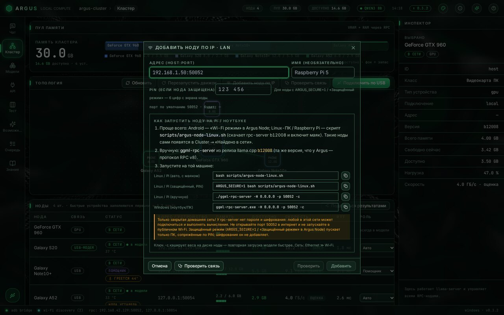
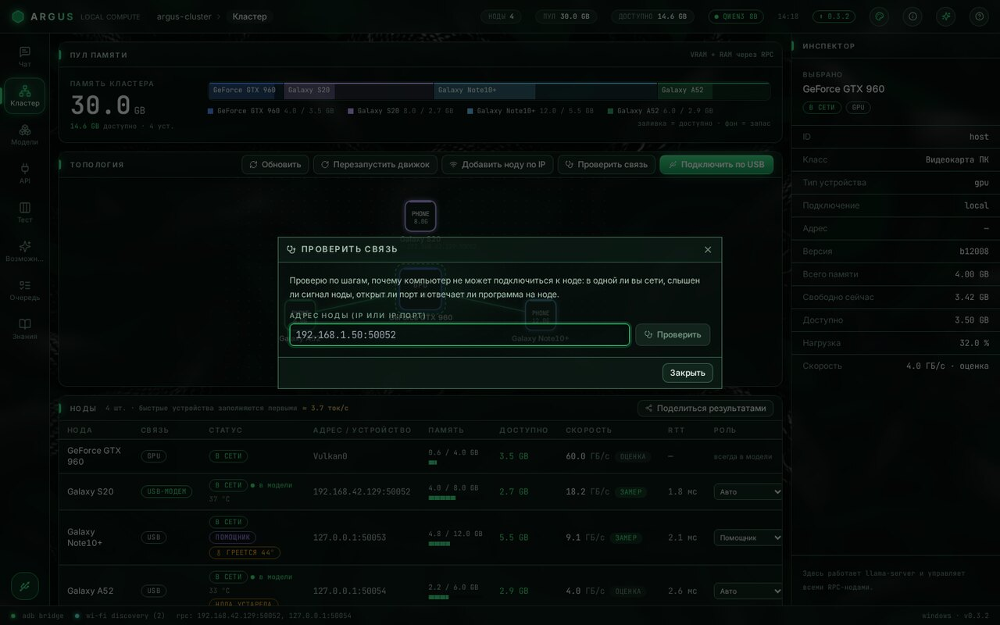

# Второй компьютер или ноутбук как нода Argus

[English version](PC-NODE.en.md)

Есть два компьютера? Пусть второй помогает первому: отдаёт свою память и процессор (или видеокарту), и в Argus влезают модели побольше. Это может быть старый ноутбук, второй ПК, Linux-машина — что угодно 64-битное.

- **Главный компьютер** — тот, где установлен Argus и где ты пишешь в чат.
- **Нода (помощник)** — второй компьютер. На нём Argus ставить **не нужно**, только маленькую программу-ноду (llama.cpp `rpc-server`).

> ⚠ **Только дома.** У ноды нет пароля и шифрования: любое устройство в той же сети может к ней подключиться. Не запускай её в кафе, общаге или на работе и не пробрасывай порт 50052 в интернет.

## Что нужно

1. Оба компьютера в **одной домашней сети**: один Wi-Fi (не гостевой) или один роутер по кабелю. Кабель быстрее Wi-Fi.
2. Интернет на ноде — один раз, чтобы скачать llama.cpp (~25–40 МБ; для видеокарт NVIDIA с CUDA — до 600 МБ).
3. На главном компьютере — Argus 0.3 или новее.

---

## Вариант 1. Нода на Windows

### Шаг 1. Запусти ноду

**Способ А — одна команда.** Нажми **Win + R**, введи `powershell`, нажми Enter. В синем окне вставь (правый клик мыши) и нажми Enter:

```
irm https://raw.githubusercontent.com/slopmaster1884/Project-argus/main/scripts/argus-node-windows.ps1 -OutFile $env:TEMP\argus-node.ps1; powershell -ExecutionPolicy Bypass -File $env:TEMP\argus-node.ps1
```

**Способ Б — двойной клик.** Скачай проект: на [странице GitHub](https://github.com/slopmaster1884/Project-argus) зелёная кнопка **Code → Download ZIP**, распакуй, открой папку `scripts` и дважды щёлкни **`argus-node-windows.cmd`**. Если Windows пишет «Система Windows защитила ваш компьютер» — «Подробнее» → «Выполнить в любом случае».

Что сделает скрипт:

1. Спросит, добавить ли **правило Windows Firewall** для порта 50052. Отвечай `y`. Windows покажет окно «Разрешить этому приложению вносить изменения?» — нажми **«Да»**. Это единственное место, где нужны права администратора.
2. Сам выберет сборку llama.cpp b12008: **CUDA**, если есть видеокарта NVIDIA со свежим драйвером; **Vulkan**, если есть драйвер видеокарты с Vulkan (AMD, Intel, NVIDIA); иначе **процессор**. Скачает её в `%LOCALAPPDATA%\ArgusNode`.
3. Запустит ноду и **крупно напишет IP-адрес** этого компьютера и что нажать в Argus.

Нода работает, пока открыто окно. Остановить: **Ctrl + C**.

Если при первом запуске Windows сама спросит «Разрешить доступ `ggml-rpc-server`?» — поставь галочку **«Частные сети»** и нажми «Разрешить».

### Шаг 2. Автозапуск (по желанию)

Чтобы нода запускалась сама при входе в Windows, запусти то же самое с `-Install`:

```
powershell -ExecutionPolicy Bypass -File $env:TEMP\argus-node.ps1 -Install
```

или `argus-node-windows.cmd -Install` из папки `scripts`. Нода будет работать в фоне без окна (задача «Argus Node» в Планировщике заданий). Журнал: `%LOCALAPPDATA%\ArgusNode\node.log`.

Удалить всё (автозапуск, правило файрвола, файлы): то же с `-Uninstall`.

Полезные параметры: `-Backend vulkan` (или `cpu`, `cuda`) — выбрать сборку вручную; `-BeaconTarget 192.168.1.10` — слать маяк прямо на главный ПК (см. «Если не работает»); `-Lang en` — сообщения на английском.

---

## Вариант 2. Нода на Linux

Открой терминал (**Ctrl + Alt + T**), вставь (**Ctrl + Shift + V**) и нажми Enter:

```
curl -fsSL https://raw.githubusercontent.com/slopmaster1884/Project-argus/main/scripts/install.sh | bash
```

Установщик всё проверит, спросит про файрвол и автозапуск и покажет IP-адрес. Подробно, по шагам: [LINUX.md, раздел B](LINUX.md#b-linux--помощник-нода).

---

## Шаг 3. Добавь ноду на главном компьютере

1. Открой Argus → вкладка **Cluster**.
2. В списке **«Найдено в сети»** найди второй компьютер (по имени) и нажми **«Добавить»**.
3. Через несколько секунд статус станет зелёным. Всё: при следующем запуске модели Argus сам отдаст ноде часть слоёв.

Нет в списке? Нажми **«Добавить ноду по IP»** и введи адрес, который показал скрипт, с портом: например `192.168.1.23:50052`.



Как узнать IP второго компьютера вручную:
- **Windows:** Win + R → `cmd` → `ipconfig` → строка «IPv4-адрес» у адаптера Wi-Fi или Ethernet.
- **Linux:** `hostname -I` → первое число вида `192.168.x.x`.

---

## Если не работает

Сначала нажми **Кластер → «Проверить связь»**: Argus сам проверит сеть, порт, файрвол и версию и подскажет, что исправить.



| Что видишь | В чём дело и что делать |
|---|---|
| Второй ПК есть в «Найдено в сети», но после «Добавить» становится **OFFLINE** | **Файрвол** не пускает подключение к порту 50052. Windows: запусти скрипт с `-OpenFirewall` и нажми «Да». Проверь, что сеть в Windows **частная**: Параметры → Сеть и Интернет → Wi-Fi → твоя сеть → Тип сетевого профиля → «Частная» (правило работает только для частных сетей). Linux: `bash ~/.local/share/argus-node/src/argus-node-linux.sh --open-firewall`. Сторонний антивирус с файрволом (Касперский, ESET, Avast…) — разреши в нём `ggml-rpc-server.exe` или порт 50052. |
| Второго ПК **нет** в «Найдено в сети» | 1) Оба компьютера в одной сети? Гостевой Wi-Fi и «сеть 5 ГГц / 2,4 ГГц» у некоторых роутеров — разные сети. 2) Добавь по IP (шаг 3) — это работает и без списка. 3) Включена **изоляция клиентов** (AP isolation, «изоляция точки доступа», «Client isolation») в настройках роутера — она запрещает устройствам видеть друг друга; выключи её для домашней сети. 4) Роутер режет широковещание: запусти ноду с адресом главного ПК — Windows: `-BeaconTarget <IP главного ПК>`, Linux: `curl … \| ARGUS_BEACON_TARGET=<IP главного ПК> bash`. |
| Добавил по IP, но всё равно OFFLINE | Проверь связь. На главном Windows-ПК: `Test-NetConnection <IP ноды> -Port 50052` в PowerShell → должно быть `TcpTestSucceeded : True`. Если `False` — файрвол на ноде (см. первую строку) или изоляция клиентов в роутере. |
| «Порт 50052 уже занят» | Нода уже работает (например, автозапуском) — проверь Диспетчер задач (`ggml-rpc-server.exe`). Либо на этом же компьютере запущен сам Argus: он тоже использует порты 50052+ для телефонов по USB. Закрой Argus на ноде — на помощнике он не нужен. |
| «rpc-server протокол v… — нужен v8» | На ноде другая версия llama.cpp. Скрипты ставят ровно b12008; если ставил llama.cpp сам — удали ноду (`-Uninstall` / `--uninstall`) и поставь скриптом. |
| «rpc-server занят другим клиентом» | Нода обслуживает только один главный компьютер одновременно. Закрой Argus на другом ПК или убери из него эту ноду. |
| Скрипт PowerShell не запускается: «выполнение сценариев отключено» | Запускай именно так, как написано выше (`-ExecutionPolicy Bypass`) или через `argus-node-windows.cmd` — менять настройки Windows не нужно. |
| Скачивание CUDA слишком большое/долгое | Возьми Vulkan: `-Backend vulkan` (~40 МБ, на NVIDIA тоже работает). |
| Модель стала работать **медленнее** с нодой | Wi-Fi — узкое место: каждый токен ходит по сети. Подключи оба ПК к роутеру кабелем, или поставь ноде меньший «вес скорости» в инспекторе ноды в Argus. Если модель целиком влезает в видеокарту главного ПК, Argus сам не будет трогать ноду. |

Не помогло? Открой [Issue](https://github.com/slopmaster1884/Project-argus/issues/new) и приложи: что за система на ноде, последние 30 строк окна ноды (или `%LOCALAPPDATA%\ArgusNode\node.log`), и на главном ПК — кнопку **«Копировать журнал»**.

## ⚠ Безопасность

`rpc-server` из llama.cpp не умеет пароли и шифрование. Нода — **только для домашней сети**: не запускай её в общественных сетях и не открывай порт 50052 в интернет (не делай «проброс портов» на роутере). Правило Windows Firewall, которое ставит скрипт, действует только в **частных** сетях. Выключить ноду: Ctrl+C в её окне или `-Uninstall`.
